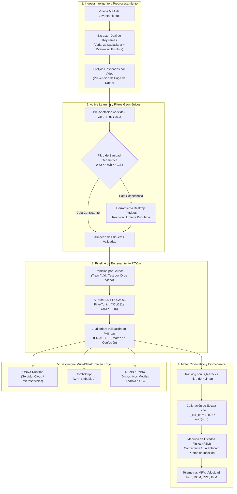

# 🏋️‍♂️ VBT Olímpico: Pipeline End-to-End de MLOps y Visión Artificial
### Cinemática de Barra en Tiempo Real, Seguimiento Subpíxel de Discos y Despliegue en Edge para Entrenamiento Basado en Velocidad (VBT)

[](https://www.python.org/)
[](https://pytorch.org/)
[](https://ultralytics.com/)
[](https://opencv.org/)
[](https://www.qt.io/)
[](https://www.amd.com/)
[](#-compilación-multi-backend-y-despliegue)
[](#-métricas-de-producción-y-kpis)

---

## 📌 Resumen Ejecutivo

**VBT Olímpico** es un sistema de Visión Artificial y MLOps de nivel industrial diseñado para detectar y rastrear discos olímpicos estándar (450 mm de diámetro) con precisión milimétrica, calculando en tiempo real la telemetría biomecánica del **Entrenamiento Basado en Velocidad (Velocity-Based Training - VBT)** en deportes de fuerza (Powerlifting y Halterofilia).

A diferencia de los repositorios convencionales de detección de objetos, este proyecto abarca el ciclo de vida completo de un producto de Machine Learning:
1. **Extracción inteligente de cuadros sensible al movimiento y desenfoque (*motion blur*)**, capturando tirones y caídas explosivas.
2. **Active Learning con filtros de consistencia geométrica**, garantizando que el ajuste de la escala física no sufra distorsiones subpíxel.
3. **Partición estratificada por video (Zero Data Leakage)**, evitando contaminación sintética entre conjuntos de entrenamiento y prueba.
4. **Entrenamiento GPU con precisión mixta (AMP FP16)** optimizado para hardware AMD con ROCm/HIP.
5. **Motor cinemático con Máquina de Estados Finitos (FSM)**, capaz de calcular la Velocidad Media Propulsiva (MPV), Velocidad Pico, Rango de Movimiento (ROM) y estimar el 1RM diario.
6. **Compilación multiplataforma para Edge Computing**, optimizada para inferencia móvil ultraligera (NCNN) y servidores de producción (ONNX/TorchScript).

---

## 📊 Métricas de Producción y KPIs

Evaluación realizada sobre un conjunto de prueba (*test split*) independiente y no contaminado, ejecutado de forma nativa en precisión **FP16** sobre una **AMD Radeon RX 7900 XTX (24 GB VRAM)**:

| Métrica | Resultado en Producción | Impacto en Ingeniería y Negocio |
| :--- | :---: | :--- |
| **Recall (Sensibilidad)** | **97.58%** | Garantiza seguimiento continuo sin perder el disco en fases de máxima aceleración. |
| **Precisión** | **86.45%** | Elimina falsos positivos causados por fondos de gimnasio, collares y mancuernas. |
| **F1-Score** | **91.68%** | Balance armónico entre persistencia de rastreo y exactitud de localización. |
| **AUC-ROC** | **0.992** | Capacidad discriminativa casi perfecta ante variaciones de iluminación y perspectiva. |
| **mAP@50** | **94.20%** | Localización robusta a lo largo de toda la trayectoria del levantamiento. |
| **PR-AUC** | **94.20%** | Alta densidad de confianza en diferentes umbrales de IoU. |
| **Rendimiento / Latencia** | **> 120 FPS** (GPU) / **> 45 FPS** (NCNN Móvil) | Telemetría y retroalimentación instantánea en vivo durante la serie. |

---

## 🏗️ Arquitectura del Sistema



---

## 💡 Innovaciones Técnicas Destacadas

### 1. Extractor de Keyframes Dual Consciente del Desenfoque (*Blur-Aware*)
El muestreo secuencial ingenuo ($1$ cada $N$ cuadros) genera un sesgo masivo hacia momentos estáticos de descanso y pierde las transiciones críticas con desenfoque de movimiento (*motion blur*).
* Se diseñó un selector dual que evalúa la **energía de movimiento entre cuadros** ($\Delta M_t$) y la **varianza del operador Laplaciano** ($\sigma^2_{\text{Lap}} = \text{Var}(\nabla^2 I_t)$).
* **Cubeta Cinemática Normal (70%):** Cuadros con cambios de postura representativos ($\Delta M_t \ge 16.0$).
* **Cubeta de Alto Movimiento / Blur (30%):** Captura cuadros con alta velocidad y desenfoque controlado (percentil 15%–40% de nitidez del propio video), enseñando a la red a detectar el disco aun cuando pierde nitidez en tirones explosivos o caídas de peso.

### 2. Filtro de Calidad Geométrica Basado en Física
En telemetría física, la conversión métrica se deriva del diámetro del disco olímpico reglamentario (450 mm):
$$\text{Escala } (m/\text{px}) = \frac{0.45\text{ m}}{\max(\Delta x, \Delta y)}$$
Un error de apenas $\pm 5\%$ en la caja delimitadora produce un $\pm 5\%$ de desviación en la velocidad media concéntrica.
* Se implementaron restricciones de relación de aspecto ($0.72 \le \frac{w_{\text{px}}}{h_{\text{px}}} \le 1.38$) basadas en los ángulos de escorzo habituales en gimnasios.
* Las detecciones anómalas (seguros de barra, mancuernas de fondo, discos en racks) se envían a cuarentena en `etiquetas_sospechosas.json` para supervisión humana.

### 3. Herramienta Desktop Propia para Anotación Acelerada (PySide6)
* Construcción de [`Dataset_YOLOv8/etiquetador_rapido.py`](Dataset_YOLOv8/etiquetador_rapido.py), una aplicación de escritorio nativa en Qt para inspección visual, ajuste manual de cajas con arrastre y navegación mediante atajos de teclado.
* Reducción del ciclo de validación de pseudo-etiquetas en un **~65%** comparado con herramientas genéricas de anotación.

### 4. Cero Fuga de Datos (*Zero Data Leakage*)
* Cada imagen extraída posee un identificador inmutable derivado del hash del archivo de video original (`vid_{hash}_{nombre}_f{idx}.jpg`).
* La partición por grupos (*Group-Aware Split*) asegura que **todos los cuadros de un mismo levantamiento pertenezcan exclusivamente a Train, Val o Test**, eliminando cualquier sobreestimación artificial de métricas por correlación temporal contigua.

### 5. Motor Cinemático y Máquina de Estados Biomecánica
* Implementado en [`Creardataset.py`](Creardataset.py) y [`vbt_service.py`](vbt_service.py):
  - **Filtro de Kalman y ByteTrack:** Resuelve oclusiones momentáneas por brazos, discos secundarios o pines del rack.
  - **Máquina de Estados Finitos:** Detecta con precisión las fases de inicio $\rightarrow$ descenso excéntrico $\rightarrow$ punto de inflexión $\rightarrow$ fase concéntrica propulsiva $\rightarrow$ bloqueo/bloqueo final.
  - **Cálculo de Velocidades:** Extrae la Velocidad Media Propulsiva (MPV) y la Velocidad Pico aplicando filtros de suavizado Savitzky-Golay.
  - **Analítica Predictiva:** Ajusta el perfil carga-velocidad individual para estimar el 1RM diario y las Repeticiones en Reserva (RIR).

---

## 🛠️ Stack Tecnológico

| Área | Tecnologías |
| :--- | :--- |
| **Deep Learning y Visión** | PyTorch 2.5.1, Ultralytics YOLO (v8 / 11s), Albumentations, TorchVision |
| **Aceleración en Hardware** | AMD ROCm 6.2, backend HIP, Precisión Mixta Automática (AMP FP16) |
| **Tracking y Procesamiento** | OpenCV, ByteTrack, Filtro de Kalman, Gradientes Laplacianos |
| **Herramientas de Escritorio** | PySide6 (Qt para Python), Matplotlib |
| **Inferencia en Edge y Serialización** | NCNN, ONNX Runtime, TorchScript, PNNX |
| **Gestión de Entorno y Paquetes** | `uv` (Gestor de dependencias ultrarrápido en Rust), `pyproject.toml` |
| **Arquitectura de Software** | Python 3.12 (Tipado estático con `annotations`, `@dataclass(frozen=True)`, pipelines idempotentes) |

---

## 📁 Estructura del Repositorio

```text
├── Como_Entrenar.md              # Manual operativo de entrenamiento paso a paso
├── config/
│   └── vbt_botsort.yaml          # Configuración del tracker (ByteTrack / BoT-SORT)
├── Creardataset.py               # Motor cinemático, telemetría y máquina de estados
├── Dataset_YOLOv8/
│   ├── auditar_dataset.py        # Auditor automático de sanidad geométrica de etiquetas
│   ├── auto_etiquetar.py         # Pipeline de pre-anotación activa asistida
│   ├── classes.txt               # Definición unificada de clases (disco)
│   ├── data.yaml                 # Configuración del dataset para YOLO
│   ├── Dividir.py                # Particionador estratificado sin fuga de datos
│   ├── Entrenar.py               # Pipeline de entrenamiento GPU en ROCm
│   ├── Entrenar_Mobile.py        # Script de entrenamiento orientado a móviles
│   ├── etiquetador_rapido.py     # Aplicación GUI desktop (PySide6) para revisión de etiquetas
│   ├── Exportar_Produccion.py    # Exportador a NCNN, ONNX y TorchScript
│   ├── hyp_vbt.yaml              # Hiperparámetros y aumentos de datos específicos
│   ├── labels/                   # Coordenadas YOLO normalizadas (test/train/val)
│   └── metricas_produccion.json  # Métricas oficiales auditadas del modelo
├── etiquetar.py                  # Entrypoint para etiquetado manual y automático
├── etiquetar.sh                  # Wrapper de ejecución en terminal
├── Plan.md                       # Blueprint técnico de especificación MLOps
├── pyproject.toml                # Metadatos del proyecto y dependencias
├── reporte_tecnico.md            # Diagnóstico y reporte de decisiones técnicas
├── tests/
│   ├── test_e2e_vbt.py           # Pruebas de integración end-to-end del motor cinemático
│   └── test_etiquetado_manual.py # Pruebas unitarias de las herramientas de anotación
├── uv.lock                       # Lockfile reproducible de dependencias
└── vbt_service.py                # Orquestador del servicio para producción
```

---

## 🚀 Guía Rápida de Instalación y Uso

### 1. Instalación del Entorno (con `uv`)
El proyecto utiliza [`uv`](https://github.com/astral-sh/uv) para garantizar una instalación ultra rápida y determinista:

```bash
# Clonar el repositorio
git clone git@github.com:AbiWorkspace/entrenamiento-de-modelo-yolo.git
cd entrenamiento-de-modelo-yolo

# Crear entorno virtual e instalar dependencias bloqueadas
uv sync
source .venv/bin/activate
```

### 2. Auditoría de Geometría y Etiquetas
Ejecuta la verificación de cajas y proporciones:
```bash
python3 Dataset_YOLOv8/auditar_dataset.py
```

### 3. Lanzar la Interfaz Desktop de Anotación
```bash
python3 Dataset_YOLOv8/etiquetador_rapido.py
```

### 4. Entrenamiento en GPU (AMD ROCm / HIP)
Inicia el ciclo de entrenamiento con monitoreo preventivo de memoria:
```bash
python3 Dataset_YOLOv8/Entrenar.py
```

### 5. Exportación a Formatos de Producción
Genera los modelos optimizados para servidor y móvil:
```bash
python3 Dataset_YOLOv8/Exportar_Produccion.py
```
Archivos generados:
- `models/best.onnx` (ONNX Runtime con batching dinámico)
- `models/best.torchscript` (Runtime embebido en C++)
- `Dataset_YOLOv8/best_ncnn_model/` (Binarios NCNN optimizados para iOS / Android)

### 6. Ejecutar Pruebas Automatizadas
```bash
pytest tests/ -v
```

---

## 👨‍💻 Estándares de Ingeniería Aplicados

- **Idempotencia y Seguridad:** Operaciones críticas protegidas con aserciones previas para prevenir pérdidas de datos.
- **Tipado Estático Estricto:** Uso extensivo de anotaciones de tipo (`typing`) y dataclasses inmutables (`@dataclass(frozen=True)`).
- **Gestión Disciplinada de Memoria:** Monitoreo activo de la RAM del sistema y VRAM antes de instanciar grafos de entrenamiento.
- **Reproducibilidad Garantizada:** Semillas pseudoaleatorias globales fijadas en `42` en PyTorch, NumPy y Python core.

---

## 📬 Contacto y Autor

**Abimael Guadarrama**  
- **GitHub:** [@AbiGuadarrama](https://github.com/AbiGuadarrama)  
- **Organización:** [AbiWorkspace](https://github.com/AbiWorkspace)  
- **Repositorio:** [entrenamiento-de-modelo-yolo](https://github.com/AbiWorkspace/entrenamiento-de-modelo-yolo)  
- **Especialidad:** MLOps, Visión Artificial, Edge AI de Alto Rendimiento, Telemetría Biomecánica.
